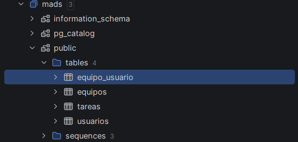
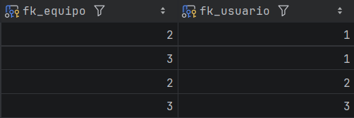
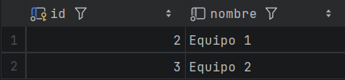
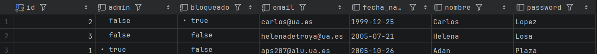

# Práctica 3: Documentación técnica (historias 009 y 010)

Este documento describe lo que he implementado en las historias de usuario **009 Gestionar pertenencia al equipo** y **010 Gestión de equipos** de la versión `1.2.0`. Cada historia está dividida en dos issues: uno hecho con TDD para el servicio y el repositorio, y otro sin TDD para el controlador y la vista.

## Base de datos PostgreSQL

Tablas de la base de datos de desarrollo PostgreSQL (`mads`) en la versión final de la aplicación:



Las tablas nuevas de esta práctica son `equipos` y `equipo_usuario`. Esta última es la tabla intermedia de la relación muchos a muchos entre `Equipo` y `Usuario`, con las columnas `fk_equipo` y `fk_usuario`:



La otra tabla `equipos` tiene los datos `id` y `nombre`



La tabla creada de `usuarios`(implementado en la anterior práctica) tiene los campos `id`, `nombre`, `password`, `admin`, `bloqueado` y `fecha_nacimiento`



## Historia 009: Gestionar pertenencia al equipo

Un usuario logeado puede crear un equipo, unirse a él y salir de él.

### Endpoints

| Ruta | Método del controlador | Método del servicio |
|---|---|---|
| `POST /equipos/crear` | `crearEquipo` | `crearEquipo(nombre)` |
| `POST /equipos/{id}/unirse` | `unirseAEquipo` | `añadirUsuarioAEquipo(equipo, usuario)` |
| `POST /equipos/{id}/salir` | `salirDeEquipo` | `eliminarUsuarioDelEquipo(equipo, usuario)` |

Los tres están en `EquiposController`, devuelven `403 Forbidden` si no hay usuario en sesión y redirigen a `/equipos` al terminar. El controlador no tiene más lógica: solo llama al método del servicio.

### Servicio (TDD)

El método nuevo de esta historia es `eliminarUsuarioDelEquipo`. Lo desarrollé con TDD en `EquipoServiceTest`:

```java
@Transactional
public void eliminarUsuarioDelEquipo(Long equipoId, Long usuarioId) {
    Equipo equipo = equipoRepository.findById(equipoId)
            .orElseThrow(() -> new EquipoServiceException("Equipo no encontrado"));

    Usuario usuario = usuarioRepository.findById(usuarioId)
            .orElseThrow(() -> new EquipoServiceException("Usuario no encontrado"));

    if (!equipo.getUsuarios().contains(usuario)) {
        throw new EquipoServiceException("El usuario no pertenece al equipo");
    }
    equipo.removeUsuario(usuario);
}
```

`removeUsuario` actualiza las dos colecciones de la relación, porque JPA no mantiene sola la parte inversa en memoria. Al principio el cambio no se guardaba porque me había olvidado de `@Transactional`.

También he añadido excepciones a `crearEquipo` para nombres en blanco o repetidos.

### Vista

En `formEquipos.html` hay un formulario para crear equipos y una tabla con todos los equipos. Para cada fila se muestra **Unirse al Equipo** o **Salir del Equipo** según si el id del usuario está entre los miembros:

```html
<form th:if="${#lists.contains(equipo.usuarios.![id], session.idUsuarioLogeado)}"
      th:action="@{/equipos/{id}/salir(id=${equipo.id})}" method="post">
```

`equipo.usuarios.![id]` es una proyección de Thymeleaf que convierte la lista de usuarios en una lista de ids.

### Tests

- `EquipoServiceTest`: `eliminarUsuarioDelEquipo`, `eliminarUsuarioQueNoPerteneceAlEquipoLanzaExcepcion`, `crearEquipoConNombreEnBlancoLanzaExcepcion`, `crearEquipoConNombreRepetidoLanzaExcepcion`.
- `EquipoWebTest`: redirecciones de crear, unirse y salir, el 403 sin sesión y qué botón aparece según si el usuario es miembro (`listaEquiposMuestraBotonSalirSiUsuarioEsMiembro`, `listaEquiposMuestraBotonUnirseSiUsuarioNoEsMiembro`).

## Historia 010: Gestión de equipos (administrador)

El administrador puede cambiar el nombre de un equipo y eliminarlo.

### Endpoints

| Ruta | Método del controlador | Método del servicio |
|---|---|---|
| `POST /equipos/{id}/update` | `updateEquipo` | `actualizarEquipo(equipo, nombre)` |
| `POST /equipos/{id}/delete` | `deleteEquipo` | `eliminarEquipo(equipo)` |

Además de la sesión, estos endpoints comprueban con `usuarioService.findById` que el usuario sea administrador. Si no lo es, devuelven 403.

El borrado lo hice primero con `@DeleteMapping`, pero lo cambié a `@PostMapping` porque un formulario HTML solo envía `GET` o `POST`.

### Servicio (TDD)

```java
@Transactional
public EquipoData actualizarEquipo(Long equipoId, String nombre) {
    if (nombre == null || nombre.isBlank()) {
        throw new EquipoServiceException("El nombre es nulo o caracter en blanco");
    }
    Equipo equipo = equipoRepository.findById(equipoId)
            .orElseThrow(() -> new EquipoServiceException("Equipo con id " + equipoId + " no encontrado"));

    Optional<Equipo> otro = equipoRepository.findByNombre(nombre);
    if (otro.isPresent() && !otro.get().getId().equals(equipoId)) {
        throw new EquipoServiceException("Equipo encontrado con ese nombre");
    }
    equipo.setNombre(nombre);
    return modelMapper.map(equipo, EquipoData.class);
}
```

Dos detalles de este método:

- No llama a `save()`. La entidad está gestionada por JPA dentro de la transacción y Hibernate guarda el cambio al hacer *commit* (*dirty checking*).
- Al comprobar si el nombre está repetido, se ignora el propio equipo. Así se puede guardar el formulario sin cambiar el nombre.

`eliminarEquipo` busca el equipo, lanza una excepción si no existe y lo borra con `equipoRepository.delete`. Los usuarios del equipo no se borran, solo las filas de `equipo_usuario`.

### Vista

Los botones **Modificar** y **Eliminar** solo se muestran si `session.esAdmin` es verdadero. "Modificar" despliega un formulario con el nombre actual ya escrito y "Eliminar" pide confirmación antes de enviar.

### Tests

- `EquipoServiceTest`: `actualizarEquipoCambiaElNombre`, `actualizarEquipoMantieneSusUsuarios`, `actualizarEquipoConSuMismoNombreNoLanzaExcepcion`, `actualizarEquipoConNombreDeOtroEquipoLanzaExcepcion`, `eliminarEquipoLoBorraDeLaBaseDeDatos`, `eliminarEquipoConUsuariosNoBorraLosUsuarios` y los casos de equipo inexistente.
- `EquipoWebTest`: redirecciones como administrador, 403 sin sesión o sin ser administrador, y que los botones solo aparezcan al administrador.
